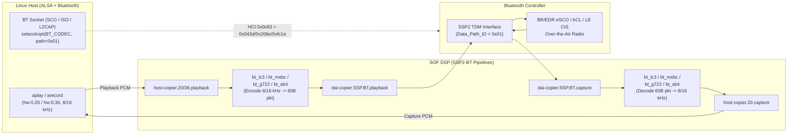

# Bluetooth Audio Offload & Transparent DSP Codec Modules (`bt_codec`)

> **Runs in:** Application — under userspace configs (e.g. PTL/WCL with `CONFIG_SOF_USERSPACE_LL`),
> these IPC4 processing modules run in MMU-isolated **user** threads. See
> [User/kernel split](../../include/sof/userspace/README.md).

This directory implements Sound Open Firmware (SOF) DSP audio encoder/decoder modules for
Bluetooth **Transparent Mode (`Coding_Format = 0x03`)** over the dedicated Bluetooth SSP audio link
(`SSP2-BT`, HCI `Data_Path_ID = 0x01`, ALSA `Bluetooth` PCM `hw:0,20`).

Together with SOF's `SSP2-BT` passthrough topologies, SOF supports **12 Bluetooth audio offload
protocols** across two architectural modes:

1. **BT Controller Hardware Offload (`BT_TRANSP_CODEC="none"`)**:
   The SOF topology connects `host-copier` directly to `dai-copier.SSP` (`SSP2-BT`), and the
   Bluetooth controller performs over-the-air audio encoding/decoding in hardware (`A2DP SBC`,
   `A2DP AAC`, `eSCO mSBC`, `eSCO CVSD`, `eSCO G.711 u-law`, `eSCO G.711 A-law`, `eSCO Transparent`
   raw PCM, and `LE Audio CIS LC3`).
2. **SOF DSP Transparent Codec Offload (`BT_TRANSP_CODEC="lc3" | "msbc" | "g722" | "sb4"`)**:
   The Bluetooth controller runs an unencoded eSCO **Transparent (`0x03`)** air link over `SSP2-BT`
   (`8 kHz` `S16_LE`), while the SOF DSP runs wideband (`16 kHz`) or narrowband (`8 kHz`) mono audio
   compression (`S16_LE` / `S32_LE`) on playback and decompression (`S16_LE`) on capture inside
   `bt_codec`.

---

## Architecture & Data Flow



### Self-Synchronizing 60-Byte Transparent Packet Framing

Over an `8 kHz` `S16_LE` eSCO `Transparent (0x03)` link, `7.5 ms` equals `60` samples (`60` bytes
when carrying 1 air byte in the upper 8 bits of each 16-bit TDM sample). Each SOF DSP codec encodes
`120` wideband (`16 kHz`) or `60` narrowband (`8 kHz`) PCM samples per `7.5 ms` frame into a
self-synchronizing `60`-byte packet so DSP-to-DSP links achieve deterministic frame lock even across
arbitrary mid-stream air byte offsets:

| Module | UUID | Algorithm | Host PCM Format | Compressed Payload (per 7.5 ms) | SSP Link Format |
|---|---|---|---|---|---|
| `bt_lc3` | `4c433301-b700-4a10-8000010203040501` | Zephyr `liblc3` (60.8 kbps, 7.5 ms) | `8 / 16 kHz` 1ch `S16_LE` / `S32_LE` | `57` bytes (`456` bits) + sync + CRC-8 | `8 kHz` 1ch `S16_LE` |
| `bt_msbc` | `4d534243-b700-4a10-8000010203040502` | Bluetooth SIG HFP v1.8 / A2DP v1.3 `mSBC` (`bitpool=26`, H2 header) | `8 / 16 kHz` 1ch `S16_LE` / `S32_LE` | `2B` H2 + `57B` mSBC + `0x00` pad | `8 kHz` 1ch `S16_LE` |
| `bt_g722` | `47373232-b700-4a10-8000010203040503` | ITU-T Rec. G.722 Mode 2 (56 kbps 2-band 24-tap QMF SB-ADPCM) | `8 / 16 kHz` 1ch `S16_LE` / `S32_LE` | `420` bits (`53B`) + sync + CRC-8 | `8 kHz` 1ch `S16_LE` |
| `bt_sb4` | `53423401-b700-4a10-8000010203040504` | Experimental 4-band tree-QMF subband ADPCM (`6/4/3/2`-bit) | `8 / 16 kHz` 1ch `S16_LE` / `S32_LE` | `450` bits (`57B`) + sync + CRC-8 | `8 kHz` 1ch `S16_LE` |

---

## Build & Topology Configuration

### 1. Firmware Build (`Kconfig`)

Enable `CONFIG_COMP_BT_CODEC=y` (enabled by default on ACE 3.0 `intel_adsp_ace30_ptl.conf` and
`intel_adsp_ace30_wcl.conf`) and ensure `west update` has fetched `modules/lib/liblc3`:

```bash
west update liblc3
./sof/scripts/xtensa-build-zephyr.py -p ptl
./sof/scripts/xtensa-build-zephyr.py -p wcl
```

### 2. Feature Topologies (`tools/topology/topology2`)

Build the production topologies:

```bash
cmake -S sof/tools -B sof/build-tools
cmake --build sof/build-tools --target topologies2 -j$(nproc)
```

Generated Bluetooth topologies (`PCM 20: Bluetooth` duplex low-latency at `hw:0,20`, plus
`PCM 36: Deepbuffer Bluetooth` playback at `hw:0,36` with a `100 ms` L2 SRAM DMA buffer and `D0i3`
streaming compatibility):
- **BT Controller Hardware Offload (`BT_TRANSP_CODEC="none"`, `BT_DEEP_BUFFER="true"`)**:
  - SoundWire RT722 (PTL / WCL): `sof-{ptl,wcl}-rt722-4ch-bt.tplg`, `sof-{ptl,wcl}-ssp2-bt-id10.tplg`
  - HDA Generic (MTL / ARL / PTL): `sof-hda-generic-ace1-bt.tplg`, `sof-hda-generic-ace3-bt.tplg`, `sof-hda-generic-ace3-{2ch,4ch}-bt.tplg`
- **SOF DSP Transparent Codec Feature Topologies (`c` in `lc3`, `msbc`, `g722`, `sb4`, `BT_DEEP_BUFFER="true"`)**:
  - SoundWire RT722 (PTL / WCL): `sof-{ptl,wcl}-rt722-4ch-bt-${c}.tplg`
  - Standalone SSP2-BT (PTL / WCL): `sof-{ptl,wcl}-ssp2-bt-id10-${c}.tplg`
  - HDA Generic (PTL): `sof-hda-generic-ace3-bt-${c}.tplg`

### 3. Linux Kernel Driver Prerequisites

On HDA-based platforms (`sof-hda-dsp`), enable the `SSP2-BT` machine driver DAI link via
`bt_link_mask=0x4` (bit `2` = `SSP2`) in `/etc/modprobe.d/sof-bt.conf`:

```ini
options snd_sof_intel_hda_generic bt_link_mask=0x4
```

Verify that ALSA exposes `card 0, device 20: Bluetooth (*)` after loading SOF:

```bash
aplay -l | grep -i bluetooth
```

---

## Hardware Testing Guide

> **Important (`codec_provider` SSP Clocking):**
> On Intel Bluetooth controllers, `SSP2-BT` (`BCLK`/`FSYNC`) is driven by the Bluetooth controller
> (`codec_provider`) **only while an offloaded SCO, ISO, or A2DP connection is active**. Always
> open the Bluetooth socket *before* (or concurrently with) `aplay`/`arecord` and keep the socket
> open until `aplay`/`arecord` finishes.

### 1. Initialize the Bluetooth Controller (Both DUTs)

Stop `bluetoothd` so raw test sockets own `PSM 0x0019` / SCO / ISO directly, and enable BR/EDR, LE,
Secure Simple Pairing (SSP), and Wideband Speech (WBS):

```bash
systemctl stop bluetooth
btmgmt --index 0 power off
btmgmt --index 0 bredr on
btmgmt --index 0 le on
btmgmt --index 0 ssp on
btmgmt --index 0 bondable on
btmgmt --index 0 wbs on
btmgmt --index 0 connectable on
btmgmt --index 0 discov on
btmgmt --index 0 power on
hciconfig hci0 piscan
```

### 2. Minimal `BT_CODEC` Offload Socket Helpers

Linux configures Bluetooth SSP offload via `setsockopt(fd, SOL_BLUETOOTH, BT_CODEC, ...)`
(`SOL_BLUETOOTH = 274`, `BT_CODEC = 19`) using `struct bt_codecs`:

```c
/* Minimal eSCO SSP offload helper: gcc -O2 sco_offload.c -o sco_offload */
#include <stdio.h>
#include <stdlib.h>
#include <stdint.h>
#include <unistd.h>
#include <poll.h>
#include <sys/socket.h>

#define BTPROTO_SCO    2
#define SOL_BLUETOOTH  274
#define BT_DEFER_SETUP 7
#define BT_CODEC       19

typedef struct { uint8_t b[6]; } __attribute__((packed)) bdaddr_t;
struct sockaddr_sco { sa_family_t sco_family; bdaddr_t sco_bdaddr; };
struct bt_codec {
    uint8_t id; uint16_t cid; uint16_t vid; uint8_t data_path; uint8_t num_caps;
} __attribute__((packed));
struct bt_codecs {
    uint8_t num_codecs; struct bt_codec codecs[1];
} __attribute__((packed));

static void parse_bdaddr(const char *s, bdaddr_t *ba) {
    unsigned int b[6];
    sscanf(s, "%x:%x:%x:%x:%x:%x", &b[5], &b[4], &b[3], &b[2], &b[1], &b[0]);
    for (int i = 0; i < 6; i++) ba->b[i] = (uint8_t)b[i];
}

/* Usage:
 *   Server: ./sco_offload listen  <codec_id> <data_path> <hold_sec>
 *   Client: ./sco_offload connect <PEER_BDADDR> <codec_id> <data_path> <hold_sec>
 */
int main(int argc, char **argv) {
    int is_srv = (argc > 1 && argv[1][0] == 'l');
    int argi = is_srv ? 2 : 3;
    uint8_t codec_id = strtoul(argv[argi], NULL, 0);
    uint8_t path = strtoul(argv[argi + 1], NULL, 0);
    int hold = atoi(argv[argi + 2]);

    int sk = socket(AF_BLUETOOTH, SOCK_SEQPACKET, BTPROTO_SCO);
    struct sockaddr_sco loc = { .sco_family = AF_BLUETOOTH };
    bind(sk, (struct sockaddr *)&loc, sizeof(loc));

    struct bt_codecs cs = {
        .num_codecs = 1,
        .codecs = {{ .id = codec_id, .data_path = path }},
    };
    if (setsockopt(sk, SOL_BLUETOOTH, BT_CODEC, &cs, sizeof(cs)) < 0) {
        perror("setsockopt(BT_CODEC)");
        return 1;
    }

    if (is_srv) {
        int defer = 1;
        setsockopt(sk, SOL_BLUETOOTH, BT_DEFER_SETUP, &defer, sizeof(defer));
        listen(sk, 1);
        int csk = accept(sk, NULL, NULL);
        if (csk < 0) { perror("accept"); return 1; }
        char ch;
        recv(csk, &ch, 1, 0);
        struct pollfd pfd = { .fd = csk, .events = POLLOUT };
        poll(&pfd, 1, 5000);
        puts("SCO SRV connected!");
        fflush(stdout);
        sleep(hold);
        close(csk);
    } else {
        struct sockaddr_sco rem = { .sco_family = AF_BLUETOOTH };
        parse_bdaddr(argv[2], &rem.sco_bdaddr);
        if (connect(sk, (struct sockaddr *)&rem, sizeof(rem)) < 0) {
            perror("connect");
            return 1;
        }
        puts("SCO CLI connected!");
        fflush(stdout);
        sleep(hold);
    }
    close(sk);
    return 0;
}
```

### 3. Testing BT Controller Hardware Offload Protocols

Ensure a passthrough `-bt.tplg` topology is active (e.g. `sof-wcl-rt722-4ch-bt.tplg` or
`sof-hda-generic-ace3-bt.tplg`).

#### A. HFP / eSCO Controller Offload (`mSBC`, `CVSD`, `u-law`, `A-law`, `Transparent`)

| Protocol | `<codec_id>` | `<data_path>` | ALSA PCM Format (`hw:0,20`) |
|---|---|---|---|
| `mSBC` (Wideband Speech) | `0x05` | `0x01` | `-r 16000 -c 1 -f S16_LE` |
| `CVSD` (Narrowband) | `0x02` | `0x01` | `-r 8000 -c 1 -f S16_LE` |
| `G.711 u-law` | `0x00` | `0x01` | `-r 8000 -c 1 -f S16_LE` |
| `G.711 A-law` | `0x01` | `0x01` | `-r 8000 -c 1 -f S16_LE` |
| `Transparent` (Raw PCM) | `0x03` | `0x01` | `-r 8000 -c 1 -f S16_LE` |

```bash
# DUT A (Responder, BD_ADDR AA:BB:CC:DD:EE:FF):
./sco_offload listen 0x05 0x01 10 &

# DUT B (Initiator): connect eSCO mSBC (0x05) over SSP2-BT (0x01)
./sco_offload connect AA:BB:CC:DD:EE:FF 0x05 0x01 10 &

# Once connected, stream & capture full-duplex audio simultaneously on both DUTs:
# On DUT B:
aplay   -D hw:0,20 -r 16000 -c 1 -f S16_LE -d 4 tone_1000hz_16k.wav &
arecord -D hw:0,20 -r 16000 -c 1 -f S16_LE -d 4 rx_dut_b.wav &

# On DUT A:
aplay   -D hw:0,20 -r 16000 -c 1 -f S16_LE -d 4 tone_500hz_16k.wav &
arecord -D hw:0,20 -r 16000 -c 1 -f S16_LE -d 4 rx_dut_a.wav &
wait
```

#### B. A2DP Controller Offload (`SBC 0x00` & `AAC 0x02`, 48 kHz Stereo)

On `BTPROTO_L2CAP` media sockets (`PSM 0x0019`), `setsockopt(SOL_BLUETOOTH, BT_CODEC)` with
`data_path = 0x01` and AVDTP Media Codec Capabilities (`id = 0x00` for SBC or `id = 0x02` for AAC)
triggers Microsoft vendor extension (`0xfc1e`) subcommands `0x08` (`Avdtp_Open`) and `0x09`
(`Avdtp_Start`), encoding `48 kHz` stereo PCM from `hw:0,20`:

```bash
# On Transmitter DUT (Low-Latency FE hw:0,20 or Deepbuffer FE hw:0,36):
aplay -D hw:0,20 -r 48000 -c 2 -f S16_LE -d 5 tone_1000hz_48k_2ch.wav &
sleep 0.3
./a2dp_tx AA:BB:CC:DD:EE:FF sbc 4   # or 'aac'
wait
```

#### D. Deepbuffer Playback & Concurrent Mixing (`hw:0,36`)

When `BT_DEEP_BUFFER=true` is enabled in topology, ALSA exposes `device 36: Deepbuffer Bluetooth`
(`hw:0,36`) alongside `device 20: Bluetooth` (`hw:0,20`). `hw:0,36` allocates a `100 ms` L2 SRAM
host-copier buffer (`lp_mode = 1`, `playback_compatible_d0i3 = true`), enforces ALSA period times
`>= 110 ms`, allows PCI `D0i3` streaming when no low-latency stream is active, and mixes in `S32_LE`
with `hw:0,20`:

```bash
# Deepbuffer A2DP playback (>= 110 ms period, D0i3 streaming eligible after 5 s):
aplay -D hw:0,36 --period-time=250000 --buffer-time=1000000 \
      -r 48000 -c 2 -f S16_LE -d 10 tone_1000hz_48k_2ch.wav &
sleep 0.3
./a2dp_tx AA:BB:CC:DD:EE:FF sbc 9
wait

# Concurrent stream mixing (Deepbuffer media on hw:0,36 + Low-Latency alert on hw:0,20):
aplay -D hw:0,36 --period-time=125000 --buffer-time=500000 \
      -r 48000 -c 2 -f S16_LE -d 6 tone_440hz_48k_2ch.wav &
aplay -D hw:0,20 -r 48000 -c 2 -f S16_LE -d 6 tone_1000hz_48k_2ch.wav &
sleep 0.3
./a2dp_tx AA:BB:CC:DD:EE:FF sbc 5
wait
```

#### C. LE Audio CIS Controller Offload (`LC3 0x06`, 16 kHz Mono)

On the CIS Peripheral, enable connectable LE Extended Advertising via HCI (`0x08 0x0036` and
`0x08 0x0039`), listen on a `BTPROTO_ISO` socket configured with `BT_CODEC` (`id = 0x06`,
`data_path = 0x01`), and connect from the CIS Central (`BT_ISO_QOS`: `interval = 10000` us,
`sdu = 40` octets):

```bash
# On CIS Peripheral (DUT A):
hcitool -i hci0 cmd 0x08 0x0036 \
  01 13 00 20 00 00 40 00 00 07 00 00 00 00 00 00 00 00 00 7f 01 00 01 00 00
hcitool -i hci0 cmd 0x08 0x0039 01 01 01 00 00 00
./iso_srv2 0x06 0x01 12 &

# On CIS Central (DUT B):
./iso_cli2 AA:BB:CC:DD:EE:FF 0x06 0x01 12 &

# Once CIS is established, run full-duplex 16 kHz PCM on hw:0,20 on both DUTs:
aplay   -D hw:0,20 -r 16000 -c 1 -f S16_LE -d 4 tone_1000hz_16k.wav &
arecord -D hw:0,20 -r 16000 -c 1 -f S16_LE -d 4 rx_iso_lc3.wav &
wait
```

---

### 4. Testing SOF DSP Transparent Codec Offload (`bt_lc3`, `bt_msbc`, `bt_g722`, `bt_sb4`)

To test DSP-to-DSP encoding and decoding on SOF, load the matching `*-bt-${c}.tplg` feature
topology (`c` in `lc3`, `msbc`, `g722`, `sb4`) on both DUTs and establish an eSCO **Transparent
(`0x03`)** connection with `data_path = 0x01`:

```bash
CODEC=lc3   # lc3 | msbc | g722 | sb4

# 1. Point active topology symlink to the feature topology and reload SOF
# Example on Wildcat Lake RT722 (DUT A):
ln -sf sof-wcl-rt722-4ch-bt-${CODEC}.tplg \
       /lib/firmware/intel/sof-ipc4-tplg/sof-wcl-rt722-4ch.tplg
rmmod snd_sof_pci_intel_ptl && modprobe snd_sof_pci_intel_ptl

# Example on Panther Lake HDA (DUT B):
ln -sf sof-hda-generic-ace3-bt-${CODEC}.tplg \
       /lib/firmware/intel/sof-ipc4-tplg/sof-hda-generic.tplg
rmmod snd_sof_pci_intel_ptl && modprobe snd_sof_pci_intel_ptl

# 2. Open eSCO Transparent (0x03) link over SSP2-BT (0x01)
# DUT A:
./sco_offload listen 0x03 0x01 10 &
# DUT B:
./sco_offload connect AA:BB:CC:DD:EE:FF 0x03 0x01 10 &

# 3. Stream & record 16 kHz wideband (or 8 kHz narrowband) PCM on hw:0,20 / hw:0,36
# DUT B (transmits 1000 Hz, captures 500 Hz):
aplay   -D hw:0,20 -r 16000 -c 1 -f S16_LE -d 4 tone_1000hz_16k.wav &
arecord -D hw:0,20 -r 16000 -c 1 -f S16_LE -d 4 rx_dut_b_${CODEC}.wav &

# DUT A (transmits 500 Hz, captures 1000 Hz):
aplay   -D hw:0,20 -r 16000 -c 1 -f S16_LE -d 4 tone_500hz_16k.wav &
arecord -D hw:0,20 -r 16000 -c 1 -f S16_LE -d 4 rx_dut_a_${CODEC}.wav &
wait
```

---

### 5. Automated Sine Tone Generation & FFT Verification

Generate clean test tones (`500 Hz` and `1000 Hz`) and verify captured recordings using a
Hanning-windowed FFT:

```bash
# Generate 500 Hz and 1000 Hz 16 kHz mono S16_LE test WAVs
python3 -c '
import wave, numpy as np
sr, dur = 16000, 6
t = np.arange(sr * dur) / sr
for hz, fn in [(500.0, "tone_500hz_16k.wav"), (1000.0, "tone_1000hz_16k.wav")]:
    pcm = (20000.0 * np.sin(2.0 * np.pi * hz * t)).astype(np.int16)
    with wave.open(fn, "wb") as w:
        w.setnchannels(1); w.setsampwidth(2); w.setframerate(sr)
        w.writeframes(pcm.tobytes())
'

# Verify RMS amplitude and dominant FFT frequency of captured WAV files
python3 -c '
import sys, wave, numpy as np
for fn in sys.argv[1:]:
    with wave.open(fn, "rb") as w:
        sr, ch = w.getframerate(), w.getnchannels()
        s = np.frombuffer(w.readframes(w.getnframes()), dtype=np.int16)[::ch].astype(np.float64)
    nz = np.where(np.abs(s) > 500)[0]
    seg = s[nz[0] + sr // 8 : nz[-1] - sr // 8] if len(nz) > sr // 2 else s
    rms = float(np.sqrt(np.mean(seg ** 2))) if len(seg) else 0.0
    fft = np.abs(np.fft.rfft(seg * np.hanning(len(seg))))
    freqs = np.fft.rfftfreq(len(seg), 1.0 / sr)
    print(f"{fn}: sr={sr} Hz, dominant={freqs[np.argmax(fft[1:]) + 1]:.2f} Hz, rms={rms:.1f}")
' rx_dut_*.wav
```
