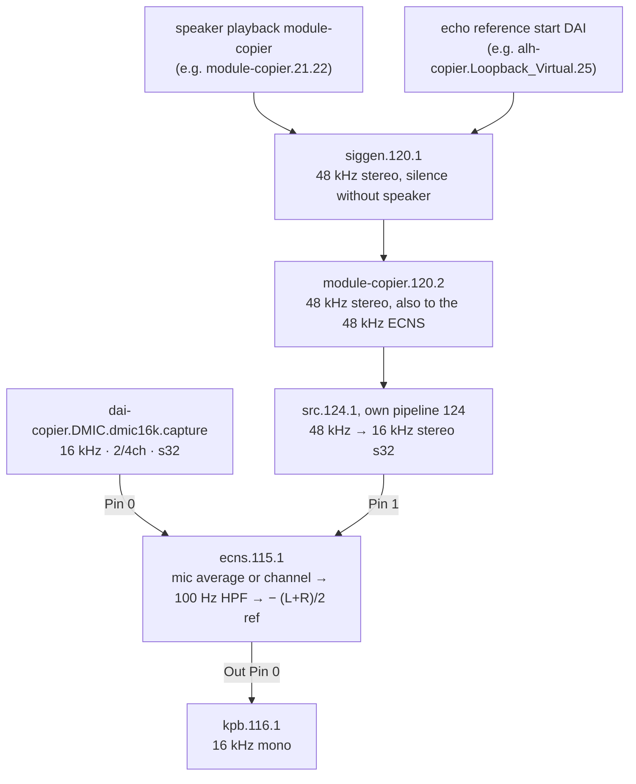

# ECNS (Echo Cancellation & Noise Suppression) Processing Module

## Overview

The `ecns` component is an IPC4 module in a 20 ms pipeline of the multi-slot
Wake-on-Voice (WoV) topology. It runs at 16 kHz or 48 kHz, the rate is taken
from the input pin 0 format in the IPC4 base config. Both inputs and the
output must have the same rate, the module does not convert rates. Other
rates are rejected when the module is created, and an echo reference with a
different rate when it is prepared. It has two input pins and one output pin,
described here for the 16 kHz WoV use:

- **Input Pin 0**: 16 kHz microphone stream from the `dmic16k` DMIC DAI copier,
  2 or 4 channels, 16 or 32 bit.
- **Input Pin 1**: 16 kHz stereo speaker echo reference, 16 or 32 bit. The
  topology provides it from the speaker playback via a siggen and a 48 kHz to
  16 kHz SRC.
- **Output Pin 0**: 16 kHz mono to the Key Phrase Buffer (`kpb.116.1`), 16 or
  32 bit. The firmware follows the channel count, channel map and bit depth of
  the consumer input format defined in topology. Up to `ECNS_OUT_CH_MAX` (4)
  output channels are supported, e.g. for a 48 kHz host capture.

ECNS is not a module adapter module, so it does not set the format of its
input buffers at bind as IPC4 consumer modules do. The copier and SRC set
the format of their output buffers, but e.g. a siggen in pass-through mode
does not. When prepared, ECNS takes the format of an input buffer without
one from the base config of the producer.

The processing for each frame is:

1. Take the microphone signal. The microphone channel enum control selects
   between the average and a single channel:
   - Mono output: average the microphone channels into mono, or take the
     selected channel.
   - Two or more output channels: with `Average` pass microphone channel *c*
     to output channel *c*. If the output has more channels than the
     microphone input, the input channels repeat. With a single channel
     selection, e.g. `Mic1`, duplicate that channel to all output channels.
2. Filter with the built-in 100 Hz second-order high-pass IIR
   (`CONFIG_ECNS_KPB_HPF`, default `y`). There are coefficients for 16 kHz
   and 48 kHz, the set is selected by the rate. Each output channel has its
   own filter state; a duplicated channel is filtered once. The filters of
   channels 1 and up are cleared when the mic channel control switches from
   a single channel to pass-through.
3. When the AEC switch is on, subtract the average of the echo reference
   channels, (L+R)/2 for stereo, from each filtered output channel with
   saturation.
4. Write the samples as s16 or s32.

The echo reference is always consumed, also when the AEC switch is off. If
the reference has fewer frames available than the microphone, the missing
frames are processed as zero. When the output is not active or is full, both
inputs are drained to prevent upstream overruns.

## Controls

The switch controls are identified by their order in the widget class
`tools/topology/topology2/include/components/ecns.conf`:

| Index | Topology name (DMIC WoV) | Function | Default |
|---|---|---|---|
| 0 | `DMIC ECNS boost` | 100 Hz high-pass with +30 dB gain when on, 0 dB when off | off |
| 1 | `DMIC ECNS AEC switch` | Subtract the echo reference from the output | off |
| 2 | `DMIC ECNS NS switch` | Noise suppression, no function yet | off |

The microphone channel enum control is the only enum control, index 0. It is
added in the widget instance with
`tools/topology/topology2/include/components/ecns/mic_sel_2ch.conf` or
`mic_sel_4ch.conf` to match the pin 0 channel count:

| Value | Topology name (DMIC WoV) | Function | Default |
|---|---|---|---|
| 0 | `DMIC ECNS mic channel` `Average` | Average of all microphone channels, or pass-through with a multichannel output | yes |
| 1..2 or 1..4 | `Mic1`, `Mic2`, (`Mic3`, `Mic4` with 4ch) | Single microphone channel, duplicated to all output channels | |

A channel beyond the input channel count falls back to `Average`.

The firmware keeps duplicate coefficient sets for the boost and only moves the
IIR coefficient pointers, so the filter state is kept. The firmware starts
boosted, but the kernel sends the switch value when the widget is set up.

## Topology

The 48 kHz DMIC stream is captured with the regular DMIC0 pipelines of
`tools/topology/topology2/platform/intel/dmic-generic.conf`, without the
TDFB and DRC enhancements, to the raw PCM. A second ECNS instance,
`ecns.122.1` in `tools/topology/topology2/platform/intel/dmic-wov-multi.conf`,
runs at 48 kHz for VoIP. It takes the microphones from the DMIC0 DAI pipeline
module-copier, before the raw PCM IIR, and the 48 kHz echo reference from
`module-copier.120.2` between the siggen and the SRC. Its controls are named
`DMIC0 ECNS boost`, `DMIC0 ECNS AEC switch`, `DMIC0 ECNS NS switch` and
`DMIC0 ECNS mic channel`. Its output and PCM 15 have the DMIC0 DAI channel
count, 2 or 4, so the multichannel output processing described above is
used.

A third instance, `ecns.151.1` in
`tools/topology/topology2/platform/intel/sdw-jack-ecns.conf`
(`INCLUDE_SDW_JACK_ECNS=true`), runs at 48 kHz for the SoundWire headset
microphone. It takes the stereo microphone from `module-copier.11.0` and the
stereo jack echo reference from `module-copier.1.12` via `siggen.150.1`. The
stereo output is captured with PCM 13 `Jack In ECNS`. Its controls are named
`Jack ECNS boost`, `Jack ECNS AEC switch`, `Jack ECNS NS switch` and
`Jack ECNS mic channel`.

## Specifications

| Parameter | Specification |
|---|---|
| Module UUID | `6c:8a:4f:21:3a:49:1e:4b:8b:1e:0d:3b:6f:8a:2c:15` |
| Sample Rate | 16 kHz or 48 kHz, the same for all pins |
| Execution Period | 20 ms (320 frames at 16 kHz, 960 frames at 48 kHz) |
| Input Pin 0 | 2 or 4 channels · s16/s32 |
| Input Pin 1 | 2 channels · s16/s32 |
| Output Pin 0 | 1 to 4 channels · s16/s32, follows the consumer input format |
| Dynamic Pipeline | Compatible (`dynamic_pipeline 1`) |
| Power States | S0 active streaming and D0i3 low-power listening supported |

## Further Reading
- [Topology2 Architecture & Verification Runbook](../../../tools/topology/topology2/README.md)
- [WOV Arbiter Architecture & State Machine](../wov_arbiter/README.md)
- [Developer Integration Guide: Custom WOV & ECNS Algorithms](../../../doc/developer_guides/wov_ecns_integration_guide.md)
