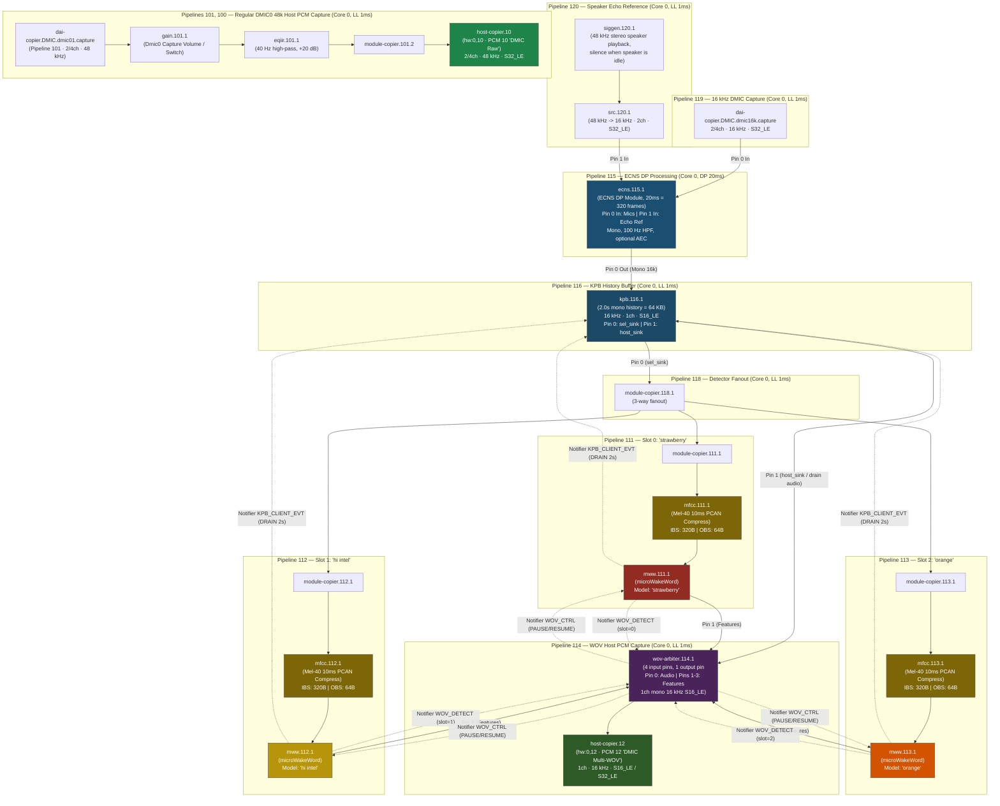

# microWakeWord (MWW) Architecture & Multi-Slot WoV Integration

This directory provides the Sound Open Firmware (SOF) component wrapping [OHF-Voice's
microWakeWord](https://github.com/OHF-Voice/micro-wake-word) streaming
keyword-spotting model, integrated with MFCC feature extraction and the
multi-slot Key Phrase Buffer (KPB) Wake-on-Voice (WoV) arbitration infrastructure.

Unlike standard single-keyword detectors or 4-way softmax classifiers, microWakeWord
executes streaming inference over a stateful TensorFlow Lite Micro (TFLM) graph,
outputting a single sigmoid wake-word probability per keyword model.

In this architecture, **one unified codebase** supports **three concurrent keyword spotter instances**:
- **Slot 0** (Pipeline 111, legacy 101): `"strawberry"`
- **Slot 1** (Pipeline 112, legacy 102): `"hi intel"`
- **Slot 2** (Pipeline 113, legacy 103): `"orange"`

---

## Architecture & Data Flow

The multi-slot MWW topology for DMIC is defined in `tools/topology/topology2/platform/intel/dmic-wov-multi.conf` and used by the SoundWire (PTL, WCL), ADL rt5682 and HDA generic `wov-multi` topologies:



The 48 kHz DMIC capture does not pass through ECNS. It is the same regular
DMIC0 capture of `dmic-generic.conf` as in the non-WoV topologies, without
TDFB/DRC (`DMIC0_ENHANCED_CAPTURE` false). The IDs above are for SoundWire;
HDA generic uses pipelines 12/11 and PCM 6, ADL rt5682 uses pipelines 14/13
and PCM 99. The speaker
playback is routed into `siggen.120.1` by the platform topology
(`SDW_SPK_ECHO_REF_ECNS`, `SPEAKER_ECHO_REF_ECNS` or `HDA_SPEAKER_ECHO_REF_ECNS`).

The SoundWire headset WoV (`sdw-jack-wov-multi.conf`, `INCLUDE_SDW_JACK_WOV=true`)
has no ECNS: `module-copier.11.0` (Jack In, 48 kHz 2ch) -> `micsel.140.1`
(`(L+R)/2` mono) -> `src.140.1` (48 -> 16 kHz) -> `module-copier.140.1`
(to 16-bit) -> `kpb.146.1` -> detector slots 141-143 -> `wov-arbiter.144.1` ->
PCM 14 `Headset Multi-WOV`.

---

## Cross-Platform Manifest Targets

The standalone DMIC-only 4-channel manifests (`dmic-wov-multi-ptl-4ch-manifest.conf`,
`dmic-wov-multi-4ch-manifest.conf`) and their `sof-*-dmic-wov-multi-4ch.tplg` targets
have been removed, because ECNS requires a speaker echo reference input that a
DMIC-only topology cannot provide. See
[`tools/topology/topology2/README.md`](../../../tools/topology/topology2/README.md)
for the remaining multi-slot WoV topology targets.

---

## Multi-Instance Design & Memory Management

### 1. Single Codebase, Three Isolated Instances
Previous implementations relied on global static variables, limiting execution to one model. The updated `mww_model.cc` introduces explicit instance tracking:

```cpp
constexpr int kMaxSlots = 3;

struct mww_instance {
    const tflite::Model* model = nullptr;
    tflite::MicroInterpreter* interpreter = nullptr;
    TfLiteTensor* input = nullptr;
    TfLiteTensor* output = nullptr;
    float input_scale = 0.0f;
    int32_t input_zero_point = 0;
    bool initialized = false;
};

static struct mww_instance g_instances[kMaxSlots];
```

### 2. Static Arena Pre-Allocation (Zero Runtime Heap Fragmentation)
Each slot is allocated a dedicated 96 KB tensor arena in the DSP BSS section:

```cpp
alignas(16) static uint8_t g_arenas[kMaxSlots][98304];
```
This guarantees deterministic execution, avoids heap fragmentation, and ensures the DSP never encounters runtime out-of-memory errors during multiple wake-word operations.

### 3. Keyword Model Dispatch
Default built-in models are bound automatically by slot/pipeline index when using `CONFIG_COMP_MWW_MODEL_PIPELINE_ID` (default):
- **Slot 0** (`pipeline_id == 111` or `101`): `mww_model_data_strawberry`
- **Slot 1** (`pipeline_id == 112` or `102`): `mww_model_data_hi_intel`
- **Slot 2** (`pipeline_id == 113` or `103`): `mww_model_data_orange`

Alternatively, a single built-in model can be forced via Kconfig (`CONFIG_COMP_MWW_MODEL_HI_INTEL`, `CONFIG_COMP_MWW_MODEL_HEY_JARVIS`, `CONFIG_COMP_MWW_MODEL_STRAWBERRY`, `CONFIG_COMP_MWW_MODEL_ORANGE`, or `CONFIG_COMP_MWW_MODEL_BANANA`), omitting all other models from the build to reduce firmware image size.

Each instance can also be dynamically customized via SOF IPC4 `LARGE_CONFIG_SET` / bytes control or LLEXT model loading.

### 4. Model Blob Format
The built-in models and the bytes control use the same model blob: `struct sof_mww_model_hdr` from [user/mww.h](../../include/user/mww.h) followed by the TFLite flatbuffer. In the bytes control the blob follows the standard `struct sof_abi_hdr`. The 64-byte header carries:
- magic `MWWM`, version and header size, so that fields can be added later,
- the model size and its CRC32, checked before the model is used, and the needed tensor arena size (0 if unknown),
- the keyword name, for information,
- the feature type (PCAN or AGC8 int8 Mel), Mel band count, hop length and hops per inference; the firmware rejects models whose feature geometry it does not support,
- the trigger threshold (Q0.8) and the number of averaged probabilities, so each model carries its own trigger tuning,
- reserved words.

A bare TFLite flatbuffer without the header is still accepted and uses the default trigger settings `MWW_DETECT_THRESHOLD_Q8` and `MWW_DETECT_AVG_LEN`.

---

## Notifier Inter-Module Signaling Contract

The MWW detector participates in SOF's synchronous intra-DSP publish/subscribe notifier bus:

1. **`NOTIFIER_ID_WOV_DETECT`**: Fired by `mww` to `wov_arbiter` on keyword detection (average probability of the last `avg_len` inferences `>= threshold_q8`, from the model header). Passes payload `{ .slot_id = cd->wov_slot_id }`.
2. **`NOTIFIER_ID_KPB_CLIENT_EVT`**: Fired by `mww` to `kpb` to request immediate draining of the 2.0 s pre-roll history buffer.
3. **`NOTIFIER_ID_WOV_CTRL`**: Received by `mww` from `wov_arbiter`.
   - `WOV_ARB_CMD_PAUSE`: Pauses inference while another slot's keyword audio is streaming to the host.
   - `WOV_ARB_CMD_RESUME`: Re-arms the detector when the host closes or resets the capture stream.

---

## ALSA Kcontrols & Userspace Verification

### 1. Active Slot Status (`DMIC Phrase Detect ID` / `Jack In Phrase Detect ID`)
The arbiter exposes a volatile read-only ALSA enum kcontrol:
```bash
# For DMIC WoV:
amixer -c 0 cget name='DMIC Phrase Detect ID'
# For SDW Headset WoV:
amixer -c 0 cget name='Jack In Phrase Detect ID'
# Values: 0 = Listening, 1 = Slot 1 ("strawberry"), 2 = Slot 2 ("hi intel"), 3 = Slot 3 ("orange")
```

### 2. Audio Capture Endpoints
- **DMIC 48 kHz Stream** (PCM 10 `DMIC Raw` on SoundWire, PCM 6 on HDA generic, PCM 99 on ADL rt5682; 40 Hz high-pass, no ECNS): `arecord -D hw:0,10 -f S32_LE -r 48000 -c 4 -d 5 /tmp/dmic48k.wav` (use `-c 2` with `NUM_DMICS=2`).
- **Mono WOV Capture Stream** (PCM 12): `arecord -D hw:0,12 -f S16_LE -r 16000 -c 1 -d 5 /tmp/wov.wav` (supports both `S16_LE` and `S32_LE`).
- **Headset Mono WOV Capture Stream** (PCM 14): `arecord -D hw:0,14 -f S16_LE -r 16000 -c 1 -d 5 /tmp/hs_wov.wav`.

---

## Further Reading
- [Developer Integration Guide: Custom WOV & ECNS Algorithms](../../../doc/developer_guides/wov_ecns_integration_guide.md)

