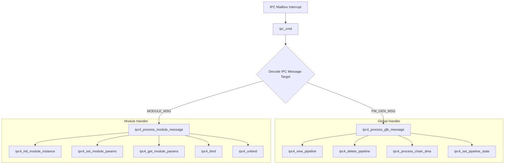
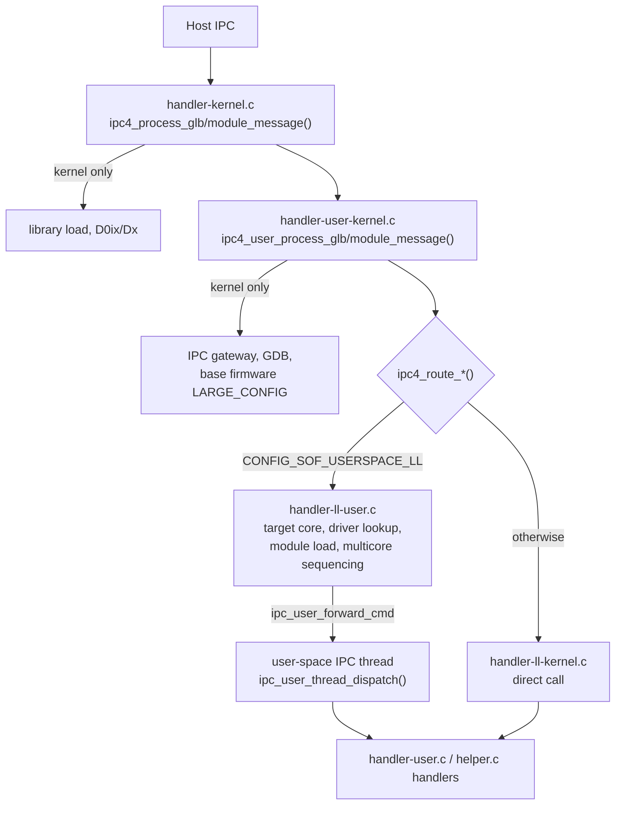
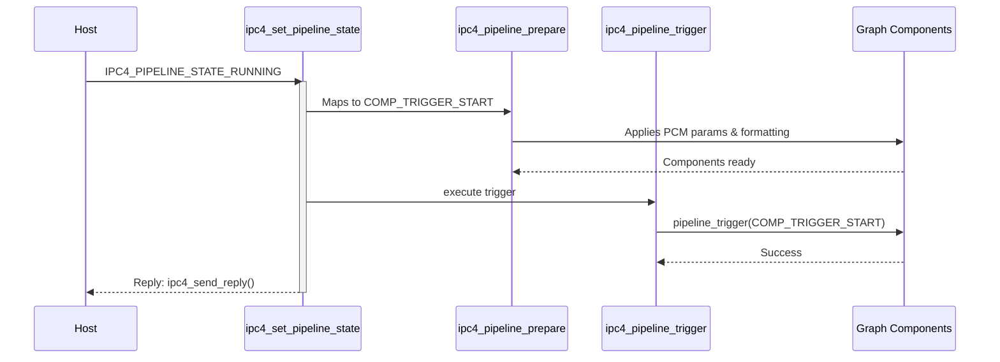
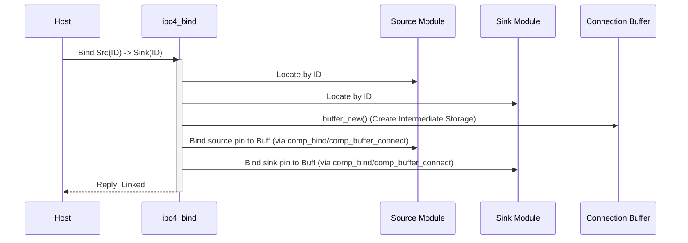

# IPC4 Architecture

> **Runs in:** Boundary / bridge — `handler-user.c` and `notification-user.c` run in the user
> thread that services modules. Their kernel counterparts are in `src/kernel/ipc/ipc4`:
> `handler-kernel.c` (the kernel dispatcher), `handler-user-kernel.c` (the global and module
> message routers), `handler-ll-user.c` and `handler-ll-kernel.c` (the routing for the LL
> scheduler in user and in kernel space) and `notification.c`, together with the
> `z_vrfy_`/`z_impl_` pairs for the compound-message, reply and notification syscalls. See
> [User/Kernel Partitioning](#userkernel-partitioning) below and
> [User/kernel split](../../include/sof/userspace/README.md).

This directory holds the handlers and topology parsing logic for Inter-Processor Communication Version 4. IPC4 introduces a significantly denser, compound-command structure heavily based around the concept of "pipelines" and dynamic "modules" rather than static DSP stream roles.

## Overview

Unlike older iterations (IPC3) which trigger single components via scalar commands, IPC4 uses compound structures. A single host interrupt might contain batch operations like building an entire processing chain, setting module parameters sequentially, and triggering a start across multiple interconnected blocks simultaneously.

## Message Handling and Dispatch

IPC4 messages are received via the generic IPC handler entry point `ipc_cmd()`. `ipc_cmd()` determines the IPC target and dispatches the message appropriately. Global messages are dispatched to `ipc4_process_glb_message()`, while module-specific messages are routed directly to `ipc4_process_module_message()`.

## User/Kernel Partitioning

With the LL scheduler in user space (`CONFIG_SOF_USERSPACE_LL`), each IPC4 message is handled
in up to two places:

- **Kernel IPC thread**: `handler-kernel.c` receives the message from the host mailbox and
  replies. It handles the kernel-only messages itself and passes the others to the routers in
  `handler-user-kernel.c`. The routers handle the messages that need kernel mode in all builds.
  For the rest they call the `ipc4_route_*()` functions of `handler-ll-user.c`, which do any
  privileged part of the message and forward it to the user-space IPC thread of the target
  core with `ipc_user_forward_cmd()`.
- **User-space IPC thread**: `ipc_user_thread_dispatch()` in `handler-user.c` runs the handlers
  in `handler-user.c` and `helper.c` for the forwarded message.

Without `CONFIG_SOF_USERSPACE_LL`, `handler-ll-kernel.c` provides the `ipc4_route_*()`
functions instead and calls the same handlers directly, so all messages are handled in the
kernel IPC thread. The split still marks which code must be user-space safe.

With `CONFIG_SOF_USERSPACE_LL`, the messages are handled as follows:

| Message | Kernel only | Kernel and user | User |
|---|---|---|---|
| `GLB_LOAD_LIBRARY`, `GLB_LOAD_LIBRARY_PREPARE` | ✓ library manager | | |
| `GLB_IPCGATEWAY_CMD` | ✓ (the IPC gateway is disabled in the LL overlay) | | |
| `GLB_ENTER_GDB` | ✓ | | |
| `MOD_SET_D0IX`, `MOD_SET_DX` | ✓ power management | | |
| `MOD_LARGE_CONFIG_GET`/`SET`, base firmware (module_id 0) | ✓ reads the IMR manifest | | |
| `GLB_CREATE_PIPELINE` | | kernel: target core; user: pipeline creation | |
| `GLB_DELETE_PIPELINE` | | kernel: owning core; user: pipeline free | |
| `GLB_SET_PIPELINE_STATE` | | kernel: pipeline list check, multicore prepare/trigger sequencing; user: prepare and trigger | |
| `GLB_CHAIN_DMA` | | kernel: driver lookup, runtime idle PM lock of started chains; user: chain DMA creation, state changes and free | |
| `MOD_INIT_INSTANCE` | | kernel: driver lookup, loadable module setup; user: component creation | |
| `MOD_CONFIG_GET`/`SET` | | | ✓ |
| `MOD_LARGE_CONFIG_GET`/`SET`, modules | | | ✓ |
| `MOD_BIND`, `MOD_UNBIND` | | | ✓ |
| `MOD_DELETE_INSTANCE` | | | ✓ |

For the messages in the user column, the kernel only selects the target core from the module
and forwards the message unchanged. DP modules and modules on another core are created by the
kernel in `ipc4_init_module_instance()`. With `CONFIG_SOF_USERSPACE_APPLICATION`, the IPCs of a
DP module are then passed on to its DP thread (`scheduler_dp_thread_ipc()`).

The other global messages (boot config, ROM control, performance measurements, multiple module
load and unload, pipeline state get, context size, save and restore, internal messages and
notifications) and the module restore messages are not implemented and are rejected by the
routers.

## Processing Flows

### Pipeline State Management (`ipc4_set_pipeline_state`)

The core driver of graph execution in IPC4 is `ipc4_set_pipeline_state()`. This accepts a multi-stage request (e.g., `START`, `PAUSE`, `RESET`) and coordinates triggering the internal pipelines.

1. **State Translation**: It maps the incoming IPC4 state request to an internal SOF state (e.g., `IPC4_PIPELINE_STATE_RUNNING` -> `COMP_TRIGGER_START`).
2. **Graph Traversal**: It fetches the pipeline object associated with the command and begins preparing it (`ipc4_pipeline_prepare`).
3. **Trigger Execution**: It executes `ipc4_pipeline_trigger()`, recursively changing states across the internal graphs and alerting either the LL scheduler or DP threads.

### Module Instantiation and Binding (`ipc4_bind`)

In IPC4, modules (components) are bound together dynamically rather than constructed statically by the firmware at boot time.

1. **Instantiation**: `ipc4_init_module_instance()` allocates the module via the DSP heap arrays based on UUIDs.
2. **Binding**: `ipc4_bind()` takes two module IDs and dynamically connects their sink and source pins using intermediate `comp_buffer` objects.

## Compound Messages (`ipc_wait_for_compound_msg`)

To accelerate initialization, IPC4 enables Compound commands. A host can send multiple IPC messages chained back-to-back using a single mailbox trigger flag before waiting for ACKs.

`ipc_compound_pre_start` and `ipc_compound_post_start` manage this batch execution safely without overflowing the Zephyr work queues or breaking hardware configurations during intermediate states.
